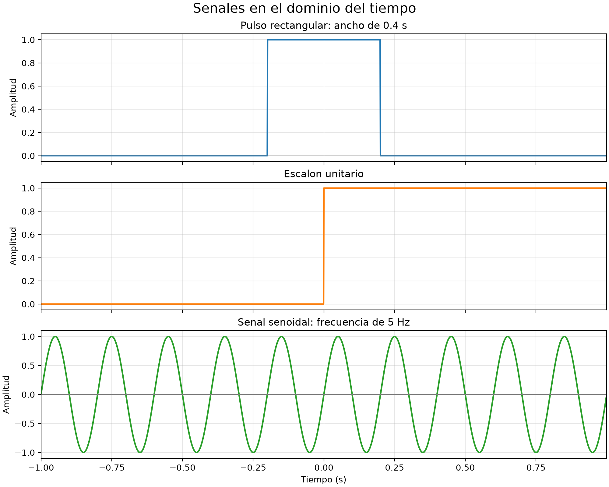
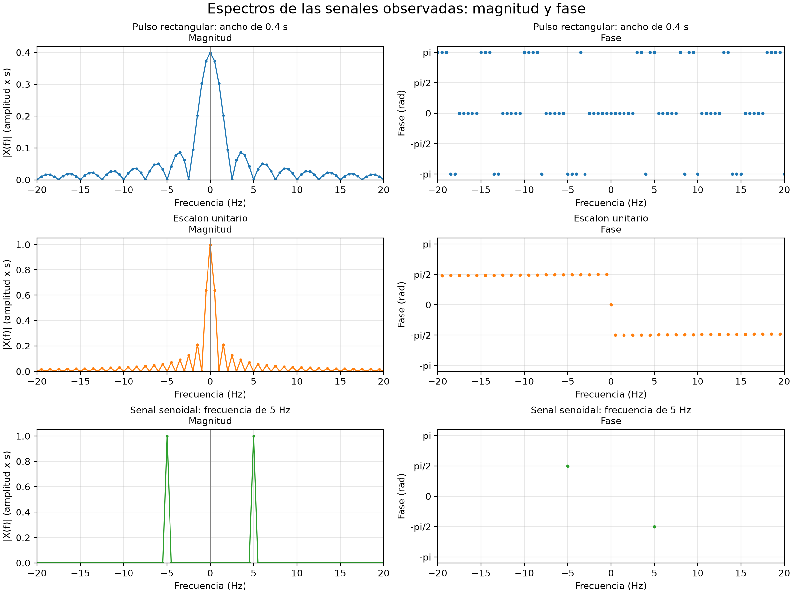
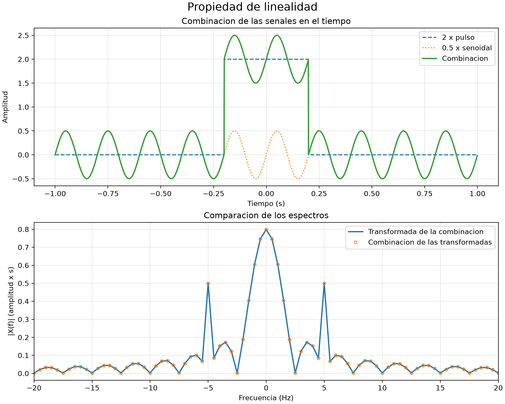
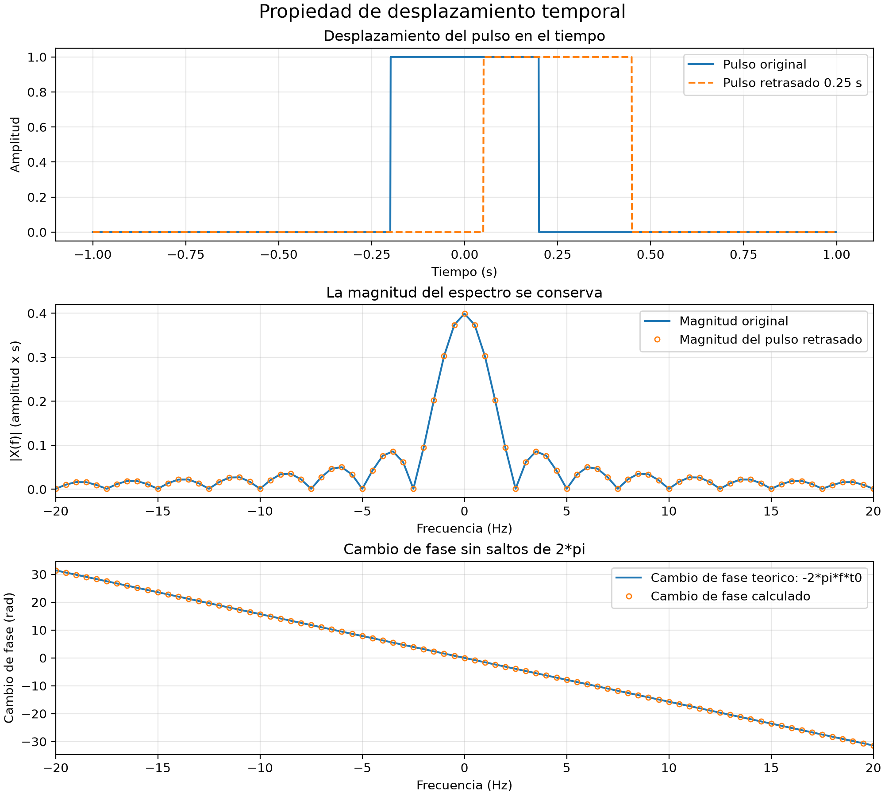
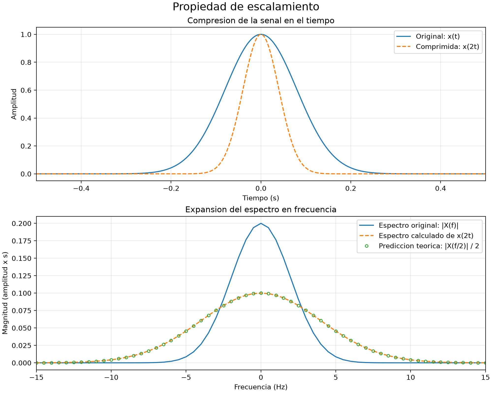

# Simulación y análisis de señales con la transformada de Fourier

Proyecto académico de **Señales y Sistemas — Actividad formativa 2**. Se implementan simulaciones en Python para estudiar señales en el dominio del tiempo y de la frecuencia y comprobar numéricamente propiedades de Fourier.

## Objetivos

- Generar un pulso rectangular, un escalón unitario y una señal senoidal.
- Representar las señales en el tiempo y calcular sus espectros mediante la FFT.
- Graficar la magnitud y la fase de los espectros.
- Verificar la linealidad, el desplazamiento temporal y el escalamiento entre tiempo y frecuencia.
- Documentar el procedimiento, los resultados y las limitaciones de la simulación.

## Herramientas

- Python 3.14 e IntelliJ IDEA con soporte para Python.
- NumPy 2.5.4: operaciones numéricas, generación de señales y FFT.
- Matplotlib 3.11.2: elaboración y almacenamiento de gráficas.
- SciPy 1.18.1: incluida en el entorno; el código actual realiza sus cálculos con NumPy.
- Git y GitHub: control de versiones y publicación del proyecto.

Las versiones de las bibliotecas se especifican en `requirements.txt`.

## Estructura del proyecto

```text
Senales-Sistemas-Fourier/
├── Main.py
├── README.md
├── requirements.txt
├── .gitignore
└── resultados/
    ├── senales_tiempo.png
    ├── espectros_fourier.png
    ├── linealidad.png
    ├── desplazamiento_temporal.png
    └── escalamiento.png
```

El entorno `.venv/`, la configuración local del editor y los archivos temporales de Python se excluyen mediante `.gitignore`.

## Instalación y ejecución en Windows

1. Obtén una copia del repositorio y abre su carpeta en IntelliJ IDEA.
2. Abre una terminal en la carpeta que contiene `Main.py`.
3. Si todavía no existe un entorno `.venv`, créalo con Python 3.14. El siguiente comando utiliza el lanzador de Python para Windows:

   ```powershell
   py -3.14 -m venv .venv
   ```

   También puedes crearlo desde IntelliJ seleccionando **Project venv** y un intérprete de Python 3.14.

4. Instala las dependencias:

   ```powershell
   .\.venv\Scripts\python.exe -m pip install -r requirements.txt
   ```

5. Ejecuta el programa:

   ```powershell
   .\.venv\Scripts\python.exe Main.py
   ```

Estos comandos utilizan directamente el intérprete del entorno virtual; no requieren activarlo en la terminal.

### Comportamiento del programa

Las cinco figuras aparecen de forma secuencial. **Cierra cada ventana para que aparezca la siguiente.** El programa también guarda las imágenes en `resultados/` y muestra las comprobaciones numéricas en la terminal.

Cada ejecución vuelve a guardar las imágenes con los mismos nombres. Para generar las cinco, permite que el programa avance hasta la última figura.

## Señales y parámetros de muestreo

| Parámetro | Valor |
|---|---|
| Frecuencia de muestreo | 1000 Hz |
| Intervalo entre muestras | 0.001 s |
| Número de muestras | 2000 |
| Duración de la ventana, N/Fs | 2 s |
| Instantes muestreados | Desde −1 s hasta 0.999 s |
| Separación entre frecuencias de la FFT, Fs/N | 0.5 Hz |

Se generan estas señales sobre el mismo eje temporal:

- **Pulso rectangular:** amplitud 1 y ancho nominal de 0.4 s, centrado en cero. La implementación asigna 1 cuando `abs(t) < 0.2` y 0 en los demás casos.
- **Escalón unitario:** vale 0 para tiempos negativos y 1 desde `t = 0`.
- **Senoidal:** `sin(2*pi*5*t)`, con amplitud 1, frecuencia de 5 Hz y periodo de 0.2 s.



## Cálculo del espectro

Se utiliza la convención de Fourier con frecuencia en hercios:

$$
X(f)=\int_{-\infty}^{\infty}x(t)e^{-j2\pi ft}\,dt.
$$

La función `calcular_espectro` aproxima esta integral para las señales observadas mediante una suma de muestras. Multiplica la FFT por el intervalo de muestreo, por lo que la escala de magnitud tiene unidades de **amplitud × segundo**.

- `np.fft.ifftshift` coloca primero la muestra correspondiente a `t = 0` de nuestro eje centrado, antes de calcular la FFT.
- `np.fft.fft` calcula la transformada discreta.
- `np.fft.fftfreq` construye las frecuencias en hercios.
- `np.fft.fftshift` ordena el espectro para mostrar las frecuencias negativas y positivas alrededor de cero.
- `np.abs` obtiene la magnitud y `np.angle` obtiene la fase en radianes.

Se calcula el espectro completo. En las gráficas de las tres señales se muestra únicamente el intervalo de −20 a 20 Hz para apreciar sus componentes principales. La fase se oculta cuando la magnitud no supera una millonésima del máximo de cada espectro.



### Interpretación de los espectros

- **Pulso rectangular:** máximo central cercano a 0.4 y lóbulos laterales, con una forma aproximada de valor absoluto de una función sinc. Su fase alterna entre 0 y valores equivalentes a π, según el signo de su transformada real.
- **Escalón observado:** contiene una componente en cero y otras componentes de frecuencia. Se analiza el segmento finito capturado por la ventana de observación; este resultado no representa directamente la transformada del escalón ideal de duración infinita.
- **Senoidal:** dos picos en −5 Hz y +5 Hz. Las fases correspondientes son aproximadamente +π/2 y −π/2. Con la normalización utilizada y una ventana de dos segundos, la magnitud de cada pico es cercana a 1.

Los valores +π y −π representan el mismo ángulo. La fase de un coeficiente exactamente nulo no está definida.

## Verificación de propiedades

### 1. Linealidad

$$
\mathcal{F}\{a x_1(t)+b x_2(t)\}=aX_1(f)+bX_2(f).
$$

Se combina dos veces el pulso rectangular con la mitad de la senoidal. Se comparan dos rutas: transformar la combinación temporal y combinar las transformadas individuales con los mismos coeficientes.

La gráfica muestra sus magnitudes superpuestas. La comprobación numérica compara los **espectros complejos completos**, incluyendo su fase.



### 2. Desplazamiento temporal

$$
\mathcal{F}\{x(t-t_0)\}=X(f)e^{-j2\pi ft_0}.
$$

Se retrasa el pulso 0.25 s, equivalentes a 250 muestras. Su centro se desplaza a `t = 0.25 s`. El desplazamiento se implementa rellenando con ceros y se comprueba que no se pierda ninguna parte no nula del pulso al salir del intervalo.

La magnitud del espectro se conserva y el cambio de fase sigue la recta `−2*pi*f*0.25`. Para visualizar esa recta, se eliminan los saltos de 2π mediante `np.unwrap` y se ajusta la referencia de fase en frecuencia cero.



### 3. Escalamiento entre tiempo y frecuencia

$$
\mathcal{F}\{x(at)\}=\frac{1}{|a|}X\left(\frac{f}{a}\right),\qquad a\ne0.
$$

Se añade una señal gaussiana como ejemplo complementario:

$$
x(t)=e^{-\pi(t/\tau)^2},\qquad \tau=0.2\ \mathrm{s}.
$$

Su transformada analítica es:

$$
X(f)=\tau e^{-\pi(\tau f)^2}.
$$

Se calcula `y(t) = x(2t)` y se compara su FFT con la predicción analítica `Y(f) = X(f/2)/2`. También se comprueba la FFT de la gaussiana original frente a su fórmula analítica.

La señal comprimida tiene la mitad del ancho temporal, medido a la misma fracción de su máximo. Su espectro tiene el doble del ancho y su máximo baja de 0.2 a 0.1. Ambas señales temporales conservan una amplitud máxima de 1.



## Resultados numéricos

Se utiliza el error relativo entre un espectro calculado y su referencia:

$$
\varepsilon=\frac{\|X_{\mathrm{calculado}}-X_{\mathrm{referencia}}\|_2}{\|X_{\mathrm{referencia}}\|_2}.
$$

Valores obtenidos con los parámetros del proyecto:

| Comprobación | Error relativo aproximado |
|---|---:|
| Linealidad | 2.193 × 10⁻¹⁶ |
| Desplazamiento temporal | 1.975 × 10⁻¹⁵ |
| Gaussiana original frente a su transformada analítica | 8.986 × 10⁻¹⁶ |
| Escalamiento | 9.021 × 10⁻¹⁶ |

Las comparaciones mediante `np.allclose`, con tolerancia relativa `1e-10` y absoluta `1e-12`, resultan verdaderas. También se comprueba por separado que la magnitud del espectro se conserve al retrasar el pulso.

Estos valores pueden variar ligeramente por redondeo numérico entre equipos. Verifican los ejemplos implementados y no sustituyen una demostración matemática general de las propiedades.

## Limitaciones de la simulación

- La FFT opera sobre un número finito de muestras. Sus resultados dependen de la frecuencia de muestreo, la duración observada y la normalización utilizada.
- La separación de 0.5 Hz corresponde a las frecuencias evaluadas por la FFT. Unir esos puntos mediante líneas facilita la visualización, pero no añade nuevas muestras espectrales.
- El pulso usa una desigualdad estricta en sus bordes. Contiene 399 muestras de amplitud 1 y su valor espectral en cero es 0.399, cercano al área ideal de 0.4. Esta diferencia procede de la discretización.
- El escalón y la senoidal están limitados por la ventana de observación. En este ejemplo, la senoidal completa diez periodos en la ventana y su frecuencia coincide con una frecuencia evaluada por la FFT.
- Las discontinuidades del pulso y del escalón contienen componentes por encima de cualquier límite de muestreo finito; sus espectros numéricos son aproximaciones de los continuos.
- La gaussiana no tiene duración finita, pero con los parámetros seleccionados sus valores en los extremos de la ventana son despreciables, lo que permite una comparación precisa con su transformada analítica.

## Conclusiones

1. El dominio del tiempo permite observar amplitudes, duraciones y posiciones; el dominio de la frecuencia describe las componentes espectrales y sus fases.
2. La senoidal concentra sus componentes en las frecuencias ±5 Hz, mientras que las transiciones del pulso y del escalón observado producen un espectro más extendido.
3. La transformación conserva las combinaciones lineales de señales, como confirma la comparación de los espectros complejos.
4. Retrasar un pulso completo modifica la fase de su espectro sin modificar su magnitud.
5. Comprimir una señal en el tiempo ensancha su espectro y modifica su escala de magnitud según el factor `1/abs(a)`.
6. Para interpretar una FFT es necesario considerar el muestreo, la ventana de observación y la normalización.

## Referencias

- [NumPy: transformada discreta de Fourier](https://numpy.org/doc/stable/reference/routines.fft.html).
- [NumPy: frecuencias de la FFT](https://numpy.org/doc/stable/reference/generated/numpy.fft.fftfreq.html).
- [Stanford, EE261: The Fourier Transform and Its Applications](https://see.stanford.edu/materials/lsoftaee261/book-fall-07.pdf).

